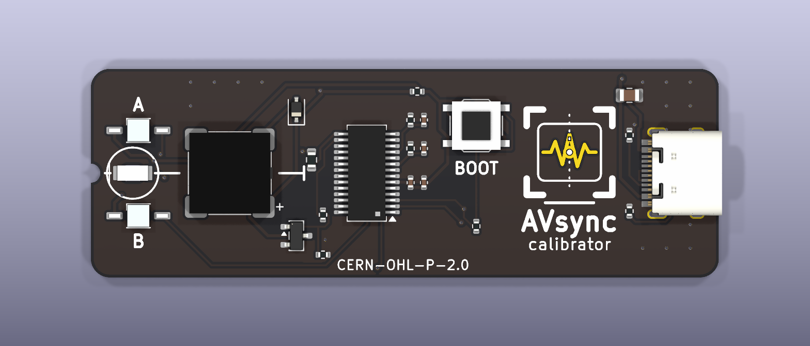
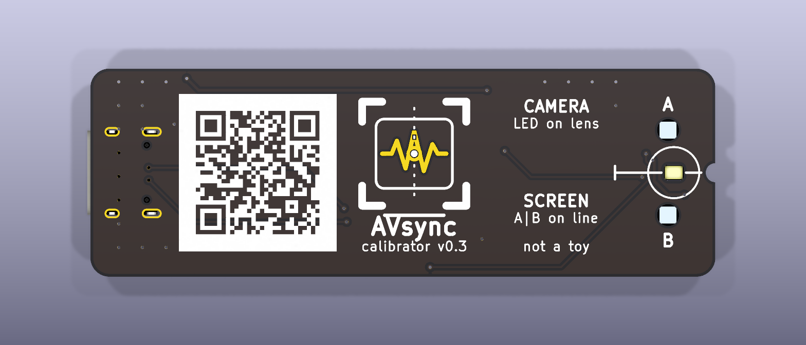

# AV Sync calibrator board

<!-- SPDX-License-Identifier: CERN-OHL-P-2.0 -->

**Status: v0.3 proposal, in development. Not ordered, not built, not tested.**

A small giveaway board (66 × 22 mm) for the AVsync app. The phone powers it over a
USB-C to USB-C cable. **No cable comes with the board: the user needs their own.**
It calibrates:

- **camera mode**: a phone's camera against its microphone (LED flash + click together),
- **display mode**: a sending screen against its speaker (the board clicks when the
  screen pattern swaps).

The board picks the mode from its two light sensors. What the app must do is in
[`docs/calibrator.md`](../../docs/calibrator.md). The firmware can be updated over the
same USB-C socket from a PC (see [Update over USB](#update-over-usb)).




Black solder mask, ENIG finish: the orange parts of the AVsync logo (waveform and the
ring in the middle) are bare gold copper; the rest of the logo is white silkscreen. The
bottom has a QR code to <https://leeo86.github.io/mxl-avsync/>.

Schematic: [`renders/calibrator-schematic.pdf`](renders/calibrator-schematic.pdf)
(also [SVG](renders/calibrator.svg)). 3D view: [`renders/calibrator-3d.png`](renders/calibrator-3d.png).

## How it works (short)

- **MCU**: WCH CH32X035G8R6 (RISC-V, QSOP-28). It runs straight from the phone's 5 V
  (2–5.5 V; 3.0–5.3 V while USB is used); 10 Ω + 1 µF/100 nF filter spikes. No regulator,
  no crystal.
- **USB-C, 16 pins**: 5.1 kΩ on CC1/CC2 so the phone turns on 5 V. D+/D− go to the MCU
  (PC17/PC16) **only for firmware updates**. The firmware never turns the USB block or its
  D+ pull-up on, so a phone sees no USB device: no "accessory not supported" message and
  no audio route change.
- **BOOT button** SW1 (update mode): connects D+ (PC17) to VDD through 4.7 kΩ (R9). The ROM bootloader
  starts only at power-on and only if PC17 is high then (CH32X035 datasheet, pin note 8).
- **Flash and click**: white LED (PA4, ~12 mA) and buzzer transistor (PA5) are on the same
  port, so one register write starts both.
- **Light sensors**: two phototransistors feed comparator 3 (PA13 +, PA2 −, hysteresis on).
  It flips at the crossing point of a black/white swap. The ADC reads the same nodes (PA0,
  PA2) for dark/light and to check that a flip is real. PB3 is the comparator output
  (used inside the firmware) and must stay unconnected.

### Choices on the update path

- **No 10 kΩ pull-down on D+.** It was meant to stop a dumb wall charger (which may put
  ~2.7 V on D+) from starting the bootloader. That case is harmless (the board just waits
  in update mode until unplugged; the phone use case is not affected, because a phone holds
  D+ low with its own 15 kΩ). A pull-down would also fight the button: with the PC's 15 kΩ
  in parallel, D+ would only reach about 2.8 V when the button is pressed, too close to the
  unknown input threshold. Without it D+ reaches ~3.8 V with a PC attached and 5 V without.
- **R9 = 4.7 kΩ** (as on community CH32X035 boards) limits the current into D+ to well under
  1 mA while the button is held.
- **No ESD part on D+/D−.** USB is only used for the occasional update, the MCU pins have
  their own protection, and an extra extended part costs $3.07 per order plus ~$0.04/board
  (+$0.35/board on the 10-board test). Revisit if boards fail.

## Mechanics: why holes through the board

The LED must touch the camera lens and the sensors must lie flat on the screen, but the
buzzer (3 mm) and the USB-C receptacle (3.2 mm) are much taller than an LED.

| Option | Cost per order | Result |
| --- | --- | --- |
| **Chosen: all parts on top, LED and sensors look down through holes, bottom side flat** | 0 extra; sensors cost ~$0.40/board more than normal ones | flat bottom touches lens and screen; one-side Economic PCBA |
| Two-sided assembly (LED + sensors on the bottom) | Standard PCBA: setup $51.12 instead of $8.18, stencil $16.42, fixtures $41 (100 pcs), $0.48/board minimum | ≈ +$1.00/board at 100 |
| LED and sensors on the top, board lies parts-down | 0 | does not lie flat: buzzer and plug are 3 mm tall |

Parts that make the hole idea work, all in JLC stock:

- **LED**: XINGLIGHT XL-3216UWC-FB, a white *reverse-mount* 1206 LED. Its lens sits in a
  2.1 × 1.7 mm cut-out and shines through the board. Lite-On LTW-C230DS (C575513) fits the
  same footprint as a second source.
- **Sensors**: Vishay VEMT2500X01, a *reverse-gullwing* phototransistor (visible + IR,
  ±15°). The body sits on top, the dome lens looks down through a 2.3 mm hole. With a
  **1.2 mm board** the lens ends flush with the bottom. VEMT2000X01 is the same package.
- **USB-C at the far end**: the cable plug is thicker than the board and sticks out
  ~0.5 mm below the bottom. It sits ~55 mm away from the LED and sensors, so the board tilts
  less than 1° and the LED end stays flat on the lens or screen.

Look and markings:

- **Logo** on both sides, from `assets/app-icon.svg`: on the top centred in the free area
  between the BOOT button and the USB-C, on the bottom in the middle of the board, 11 mm,
  beside the QR code; the short instructions sit at the LED/sensor end. Cyan and white strokes are silkscreen.
  The orange parts are copper with a solder-mask opening and no paste, so with ENIG they look
  gold. That copper has no net; keep-outs keep tracks and vias away from it. Like in the
  icon, the white dashed centre line and the white centre dot lie on top of the gold: the
  copper and its mask opening are cut away under them, because JLC removes silkscreen from
  bare copper. On the bottom the logo and QR are mirrored so they read right from below.
- **QR code** (bottom): `https://leeo86.github.io/mxl-avsync/`. Version 3-M, 0.45 mm modules
  (3× JLC's 0.153 mm minimum line), 4-module quiet zone, white silkscreen on black mask
  (normal polarity), no via holes inside. Checked: zxing-cpp decodes the bottom render, also
  at 1/3 size. Matrix: `scripts/qr_matrix.txt` (from `scripts/gen_qr.py`, needs `segno`).
- **Text**: one font; name 1.8–2.0 mm, sub-lines 1.0–1.2 mm, and JLC's minimum
  (1.0 mm / 0.153 mm stroke) for "not a toy", the licence (small, below the MCU); "BOOT" under SW1 (1.2 mm bold).
- **Alignment**: LED circle, `A`/`B`, the split line (on the top next to the LED and again
  behind the buzzer, so it is visible while the board lies face down) and a half-round notch
  in the board edge on the split line. Marks on both sides.
- iPhone camera bumps: the lens rings stand higher than the bump plate. The board rests on
  the ring of the lens under the LED circle; hold it lightly or tape it. The buzzer sits
  next to the LED (5 mm), sound port pointing at the LED, close to the rear microphone.
- No company name on the board. Ground copper on both layers stops light going sideways
  through the board; no vias at the optics end.

## BOM (JLCPCB/LCSC, live stock and prices checked 2026-11-08)

USD per part at the order quantity of 10 and 100 boards. Ext = extended part
($3.07 feeder fee per type, Economic PCBA).

| Ref | Part | LCSC | Lib | Qty | Stock | $ @10 | $ @100 |
| --- | --- | --- | --- | --- | --- | --- | --- |
| U1 | CH32X035G8R6, QSOP-28 | C49118551 | Ext | 1 | 800 | 0.4351 | 0.3304 |
| Q2, Q3 | VEMT2500X01 phototransistor, reverse gullwing | C3210911 | Ext | 2 | 782 | 0.3141 | 0.2306 |
| BZ1 | MLT-8530 magnetic buzzer 8.5 × 8.5 × 3 mm | C94599 | Ext | 1 | 137,398 | 0.2015 | 0.158 |
| J1 | TYPE-C 16P receptacle (SHOU HAN), USB 2.0 | C393939 | Ext | 1 | 366,678 | 0.0691 | 0.0553 |
| D1 | XL-3216UWC-FB white LED, reverse mount | C3646935 | Ext | 1 | 111,067 | 0.0164 | 0.0164 |
| SW1 | TS-1187A tact switch 5.1 × 5.1 mm (update) | C318884 | Basic | 1 | 871,253 | 0.0207 | 0.0207 |
| Q1 | S8050 NPN, SOT-23 | C2146 | Basic | 1 | 1.45 M | 0.0141 | 0.0141 |
| D2 | 1N4148WS, SOD-323 | C2128 | Basic | 1 | 2.8 M | 0.011 | 0.011 |
| C1 | 10 µF 25 V 0805 | C15850 | Basic | 1 | 8.7 M | 0.0359 | 0.0359 |
| C2 | 1 µF 0402 | C52923 | Basic | 1 | 11.5 M | 0.0058 | 0.0058 |
| C3 | 100 nF 0402 | C1525 | Basic | 1 | 34.2 M | 0.0031 | 0.0031 |
| C4, C5 | 10 nF 0402 | C15195 | Basic | 2 | 5.2 M | 0.0038 | 0.0038 |
| R1, R2 | 5.1 kΩ 0402 | C25905 | Basic | 2 | 4.5 M | 0.0023 | 0.0023 |
| R3 | 10 Ω 0402 | C25077 | Basic | 1 | 3.6 M | 0.001 | 0.001 |
| R4 | 150 Ω 0603 | C22808 | Basic | 1 | 1.3 M | 0.0015 | 0.0015 |
| R5 | 1 kΩ 0402 | C11702 | Basic | 1 | 33.7 M | 0.0013 | 0.0013 |
| R6 | 100 kΩ 0402 | C25741 | Basic | 1 | 8.8 M | 0.0012 | 0.0012 |
| R7, R8 | 22 kΩ 0402 | C25768 | Basic | 2 | 1.0 M | 0.0012 | 0.0012 |
| R9 | 4.7 kΩ 0402 | C25900 | Basic | 1 | 15.7 M | 0.0017 | 0.0017 |

**Parts per board: $1.80 @10, $1.16 @100.** Stock covers the 10 + 100 boards (U1: 800,
sensors: 782 for 220 needed). Reserve them in the JLC parts library before ordering.

## Cost (both orders, CHF, everything included, no cables)

Assumptions: Economic PCBA fees from the JLC price page (setup $8.18, stencil $1.53,
5 extended types × $3.07, 95 joints × $0.0016, Confirm Parts Placement $0.45); PCB 2-layer
66 × 22 mm, 1.2 mm, **ENIG, black mask** [estimate: $21 for 10, $42 for 100; JLC's PCB price
only comes from their JavaScript calculator]; DHL $20 / $30 [estimate]; 1 USD = 0.80 CHF;
Swiss import VAT 8.1 % (only when ≥ CHF 5) + DHL clearance CHF 11.50 + 3 %.

| | Test, 10 boards | Run, 100 boards |
| --- | --- | --- |
| Parts | $18.0 | $116.0 |
| PCBA fees | $27.0 | $40.7 |
| PCB with ENIG + black | ~$21 | ~$42 |
| DHL | ~$20 | ~$30 |
| Subtotal | $86 → CHF 69 | $229 → CHF 183 |
| VAT 8.1 % + DHL clearance | CHF 5.6 + 11.7 | CHF 14.8 + 11.9 |
| **Total** | **≈ CHF 86 (CHF 8.60/board)** | **≈ CHF 210 (CHF 2.10/board)** |

**Both orders: ≈ CHF 296**, just under the CHF 300 budget. No programmer is needed (update
over USB-C). No cables are included. Ways to get more margin: JLC Global Standard Direct
instead of DHL (−CHF 10–20), or HASL instead of ENIG on the test batch (−~CHF 15; also stays
under the VAT limit). Run the real JLC quote with `fab/calibrator-gerbers.zip` before ordering.

## Update over USB

The CH32X035 has a USB bootloader in ROM, so the board cannot be bricked and needs no
programmer.

1. Unplug the board. Hold the **BOOT** button (SW1).
2. Plug the board into a PC (USB-C to USB-C, or USB-A to C). Release after about a second.
3. The board shows up as a WCH ISP device. Flash with an open tool:
   - [`wchisp`](https://github.com/ch32-rs/wchisp) (Rust, GPL-2.0): `wchisp flash firmware/build/calibrator.bin`
   - or `chprog.py` from [wagiminator/MCU-Flash-Tools](https://github.com/wagiminator/MCU-Flash-Tools) (MIT).
4. Unplug and plug in again: the new firmware runs.

A **blank chip** (as delivered by JLC) always starts the bootloader, so the first flash
needs no button. Linux needs a udev rule for the WCH device; see the
[firmware README](firmware/README.md). In normal use (no button) the phone never sees a
USB device.

## Files

| Path | What |
| --- | --- |
| `calibrator.kicad_pro/.kicad_sch/.kicad_pcb` | KiCad 9 project |
| `calibrator.kicad_sym` | custom CH32X035G8R6 symbol with pins grouped by use |
| `calibrator.pretty/` | custom footprints (buzzer, reverse LED, reverse-gullwing sensor) |
| `3d/` | simple box 3D models for the renders (KiCad 9's image has none for some parts; renders only, not used for assembly) |
| `fab/calibrator-gerbers.zip` | gerbers + drill for JLCPCB (order **1.2 mm**, **ENIG**, **black** mask, white silk) |
| `fab/calibrator-bom-jlc.csv`, `fab/calibrator-cpl-jlc.csv` | JLC BOM and pick-and-place files |
| `renders/` | PNG renders, schematic PDF/SVG |
| `scripts/` | generators: `design.py` (parts, nets, placement) → schematic (`gen_sch.py`, drawn in code), board (`gen_pcb.py`), fab files; `check_netlist.py` checks the drawn schematic against `design.py` |
| `firmware/` | CH32X035 firmware + host tests ([README](firmware/README.md)) |

### Rebuild

Needs docker only (pinned images `kicad/kicad:9.0.9-full`, `ghcr.io/freerouting/freerouting:2.1.0`).

```sh
scripts/build.sh   # footprints, schematic + netlist check, placement, autoroute, ground stitching, ERC, DRC
scripts/fab.sh     # gerbers, drill, BOM, CPL, renders, schematic PDF/SVG
```

The autorouter does not give the same tracks every run; the committed board is the
checked one.

### Checks

- ERC: 0 violations. Netlist check: the schematic wires give exactly the nets in `design.py`.
- DRC: 0 violations, 0 unconnected (JLC rules: 0.15 mm track/space, 0.3/0.6 mm vias,
  0.3 mm copper to board edge).
- Footprints match the datasheets (U1: QSOP-28 3.9 × 9.9 mm, 0.635 mm pitch, pin 1 top left;
  the USB-C uses KiCad's HRO TYPE-C-31-M-12 footprint, same pad layout as the SHOU HAN
  C393939 drawing).
- CPL rotations: JLC's 0° is the orientation of its own footprint for each part, which is
  not always KiCad's. `scripts/jlc_files.py` adds the known offsets for the stock footprints
  (QSOP-28 +270°, SOT-23 −90°, HRO USB-C +180°; values from the community list of JLC
  corrections, e.g. matthewlai/JLCKicadTools). Custom footprints (buzzer, reverse LED,
  sensors) and the button keep KiCad's rotation. Still check every part in JLC's placement
  preview before ordering (or use "Confirm Parts Placement"); JLC also places by the pin-1
  and polarity marks in the silkscreen.

## Risks and open points

1. **Phone powers the board?** A sink with 5.1 kΩ Rd is the standard USB-C way to ask for
   5 V. iPhone 15+ and most Android phones supply it. To test with real phones, including
   that no "accessory" message appears with D+/D− wired to the MCU.
2. **Bootloader entry**: R9/SW1 values follow community boards, not a WCH document; one
   user reports an "unknown device" when powered only from USB-C. Test on the first board.
3. **Comparator interrupt path** (comparator 3 → PB3 → EXTI) and the ADC/clock register
   setup are written from the datasheet, ch32fun and WCH EVT, not tested on hardware.
4. **Buzzer delay** from coil-on to sound is unknown (expect 0.05–0.3 ms). Measure once.
5. **Sensor signal** on dim screens (22 kΩ load) and room light entering the clear sensor
   bodies from above (both sensors alike, mostly cancels).
6. **LED fit**: the reverse LED lens (1.86 × 1.4 mm) has only ~0.1 mm room in the cut-out.
7. **Stock**: U1 800 and sensors 782 at JLC; enough for 110 boards, not for many more.
8. **VDD with USB**: the datasheet allows 3.0–5.3 V while USB runs; a PC port at the top of
   the USB range (5.25 V) is just inside.

## Licence

- **Board** (KiCad project, footprints, 3D models, scripts, fab files, renders and the logo
  artwork on the board): **CERN-OHL-P-2.0**, see
  [`LICENSE-CERN-OHL-P-2.0.txt`](LICENSE-CERN-OHL-P-2.0.txt).
  `SPDX-License-Identifier: CERN-OHL-P-2.0`. It is printed small on the top silkscreen.
  CERN-OHL-S-2.0 (share-alike: changed boards must stay open) would be the alternative.
- **Firmware** (`firmware/`): MIT, like the rest of the repository. Vendored register
  definitions come from ch32fun (MIT); see [`firmware/vendor/README.md`](firmware/vendor/README.md).
